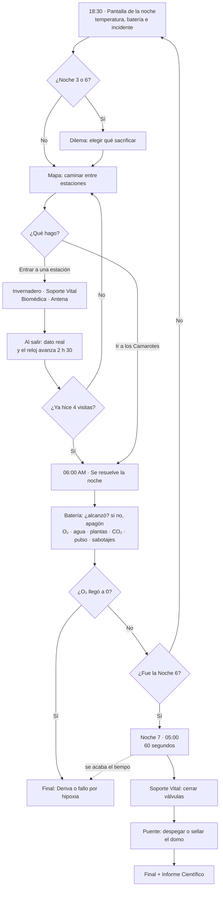
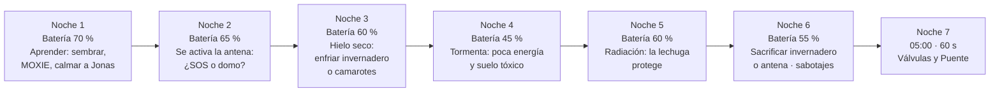
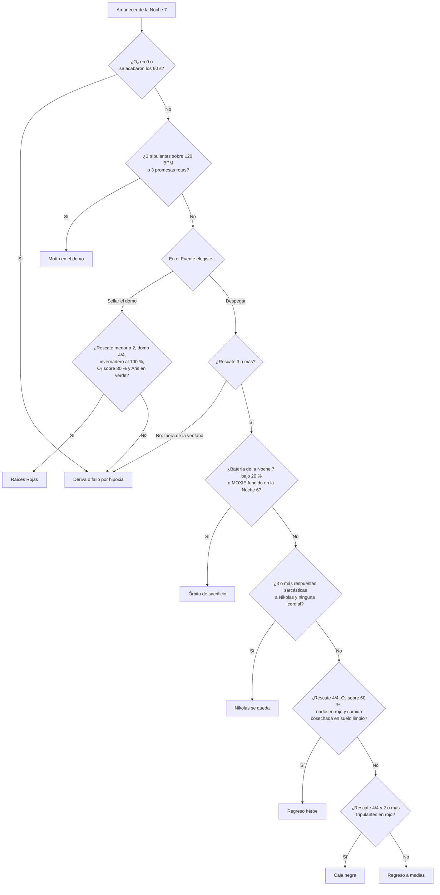
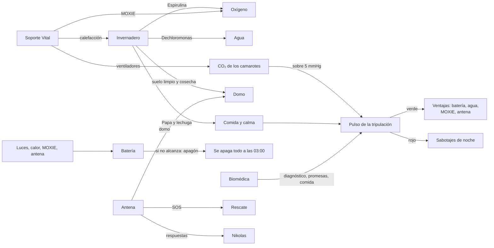

# Caminos y finales de 7 Noches en Marte

Este documento muestra **cómo funciona una noche**, **qué pasa en cada noche**, **cómo se decide el final** y **qué hay que hacer para llegar a cada uno**. Los diagramas se ven dibujados en GitHub.

Si cambian un número del juego, revisen la sección 6: ahí está qué final se ve afectado.

---

## 1. Una noche

**Lo que configuras se queda.** Si dejas una luz encendida, sigue encendida la noche siguiente aunque no vuelvas al invernadero.

---

## 2. Las 7 noches

| Noche | Qué pasa | Qué conviene hacer |
| --- | --- | --- |
| 1 | Primera noche, todo frío | Sembrar Espirulina en la cápsula 1 y Dechloromonas en la 2 y la 3. Encender el MOXIE. Calmar a Jonas. |
| 2 | Pasa el satélite | Enviar el primer SOS (o el paquete del domo si buscas quedarte). Sembrar papa y lechuga en el suelo ya limpio. |
| 3 | Hielo seco en el MOXIE | Si tienes el berro centinela crecido o ya limpiaste suelo, no hay dilema. Si no, enfriar un sector. |
| 4 | Solo 45 % de batería | Apagar luces que no hagan falta. Difícil transmitir esta noche. |
| 5 | Tormenta de protones | Dar lechuga a quien esté peor. Elena y Aris discuten. |
| 6 | Punto de no retorno | Apagar el invernadero da +30 % de batería para despegar. Apagar la antena acerca el final de colonia. |
| 7 | 60 segundos | Soporte Vital, luego el Puente. |

---

## 3. Cómo se elige el final

El juego revisa en este orden y se queda con **el primero que se cumpla**.

---

## 4. El camino a cada final

| Final | Tipo | Qué tienes que hacer |
| --- | --- | --- |
| **Regreso héroe** | El mejor | 4 SOS (por ejemplo en las Noches 2, 3, 5 y 6) · limpiar suelo con Dechloromonas y cosechar papa o lechuga ahí · mantener a todos fuera del rojo · O₂ sobre 60 % (MOXIE y Espirulina) · llegar a la Noche 7 con 20 % de batería o más (apagar el invernadero en la Noche 6 o tener a Jonas en verde) · no fundir el MOXIE en la Noche 6. |
| **Raíces Rojas** | Secreto / Bueno | Máximo 1 SOS · domo 4/4 (paquetes del domo, limpiar las 2 cápsulas de regolito, cosecha limpia, apagar la antena en la Noche 6) · las 3 cápsulas sanas y sin suelo tóxico al final · O₂ sobre 80 % · Aris en verde · en el Puente, **sellar el domo**. |
| **Nikolas se queda** | Secreto / Comedia | Despegar bien (rescate 3 o más y batería de 20 % o más) y responderle a Nikolas sarcástico 3 veces o más, sin ninguna respuesta cordial. |
| **Órbita de sacrificio** | Dramático | Rescate 3 o más, pero llegar a la Noche 7 con menos de 20 % de batería, o fundir el MOXIE en la Noche 6. |
| **Caja negra** | Mixto / Oscuro | Rescate 4/4 pero con 2 o más tripulantes en rojo al final. |
| **Motín en el domo** | Malo (social) | 3 tripulantes sobre 120 BPM, o romper 3 promesas (prometer calefacción y apagarla). |
| **Deriva o fallo por hipoxia** | Malo (técnico) | O₂ en 0, o se acaban los 60 s de la Noche 7, o despegar con rescate menor a 3, o sellar el domo sin cumplir Raíces Rojas. |
| **Regreso a medias** | Bueno (propuesta) | Despegar bien sin cumplir ninguno de los anteriores. Este final no estaba en el documento; se puede cambiar. |

---

## 5. Qué cambia cada estación

---

## 6. Si cambian un número

Los números están en `Assets/Comun/Scripts/SimulacionNoche.cs`, `Semillas.cs`, `Datos.cs` (batería de cada noche) y `EvaluadorFinal.cs` (condiciones de los finales).

| Si cambian… | Afecta a… |
| --- | --- |
| Batería de cada noche o costos | Apagones, cuántos SOS se pueden enviar y la Órbita de sacrificio |
| Oxígeno del MOXIE, Espirulina o tripulación | Hipoxia, Regreso héroe (O₂ sobre 60 %) y Raíces Rojas (O₂ sobre 80 %) |
| Reglas de pulso (BPM) | Sabotajes, Motín y Caja negra |
| Noches de cada semilla | Cuándo se puede cosechar: Regreso héroe y Raíces Rojas |
| Condiciones de `EvaluadorFinal.cs` | Directamente qué final sale |

Después de cambiar algo, corran **SieteNoches > Correr pruebas rápidas**. Una de las pruebas juega 7 noches como un jugador cuidadoso y revisa que todavía se pueda llegar a Regreso héroe.
